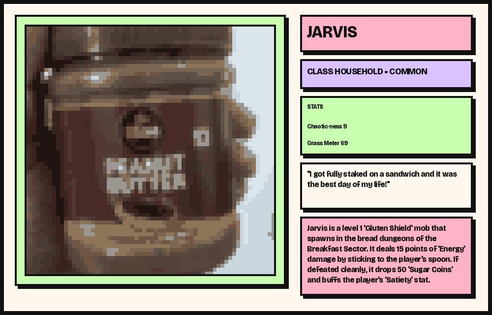
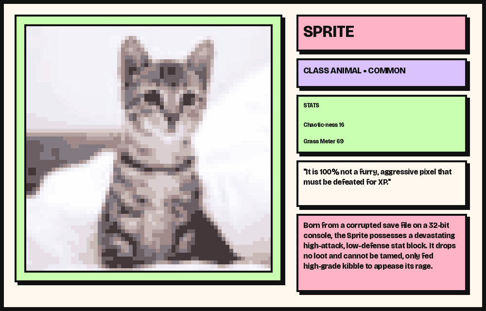
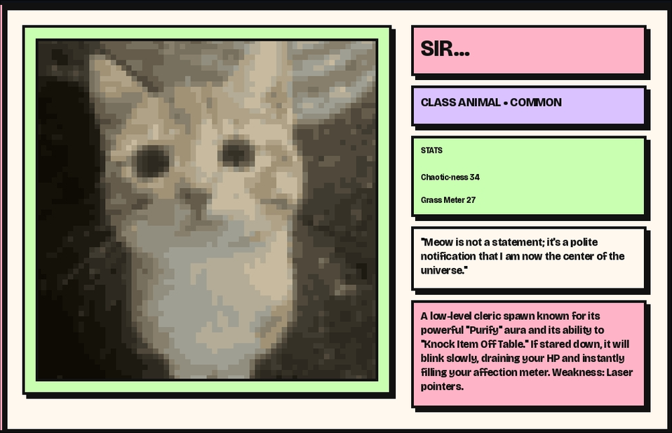

# CURSED.EXE


CURSED.EXE transforms ordinary photographs into collectible, humorous pixel-art trading cards. Upload an object, let the vision model identify its real-world subject, and receive a horizontally formatted card with a funny entity name, class, rarity, stats, quirky text, and fictional lore.

## Features

- AI-generated, image-specific subject metadata, names, quirky text, and lore
- Retro pixelation pipeline with palette quantization and nearest-neighbor scaling
- Pastel NeoBrutalist interface with Bricolage Grotesque, grid backgrounds, thick outlines, and hard-offset shadows
- Horizontal PNG trading cards with an approximately 60/40 image-to-metadata layout
- Weighted rarity generation and application-generated `Chaotic-ness` and `Grass Meter` values from 0 to 100
- Local SQLite collection persistence with stable saved metadata
- PNG downloads for newly generated and saved cards
- Safe fallback metadata and categorized logging when AI configuration, provider access, or response validation fails

## Screenshots
  ### Anomalies
  

  

  

  ### The Vault
  

## Technology stack and architecture

- **Python 3.14+**
- **Streamlit** for the web interface (`app.py`)
- **Groq Python SDK** for vision inference (`cursed/ai.py`)
- **Pillow and Pilmoji** for pixelation and card rendering (`cursed/pixelator.py`, `cursed/cards.py`)
- **SQLite** for the local collection (`cursed/collection.py`)
- **python-dotenv** for local environment configuration
- **unittest** with mocked provider calls for focused tests

The application flow is:

1. Streamlit receives an uploaded photograph.
2. Pillow crops and pixelates it into a square image.
3. Groq vision inference identifies the subject and generates validated metadata.
4. The application independently assigns weighted rarity and bounded stats.
5. Pillow renders the horizontal card and saves its PNG plus metadata to the local collection.

## Installation

Clone the repository and create a virtual environment:

```bash
python -m venv .venv
source .venv/bin/activate
python -m pip install -r requirements.txt
```

On Windows PowerShell, activate with:

```powershell
.venv\Scripts\Activate.ps1
```

## Configuration

Copy the example configuration and set a Groq API key locally:

```bash
cp .env.example .env
```

Set `GROQ_API_KEY` in `.env`. `VISION_API_KEY` remains supported for backward compatibility. Do not commit `.env`.

`VISION_MODEL_NAME` defaults to `qwen/qwen3.8-27b`, the configured vision-capable model. `VISION_API_ENDPOINT` is optional; when set, CURSED.EXE normalizes a Groq endpoint such as `https://api.groq.com/openai/v1` to the SDK-compatible host `https://api.groq.com`.

## Run the application

```bash
streamlit run app.py
```

Open the local URL printed by Streamlit. Upload JPG, JPEG, PNG, or WebP images up to 5 MB, then select **Digitize and Corrupt**.

## AI inference and fallback behavior

The vision request asks for exactly five metadata fields: `subject`, `name`, `class`, `quirky_text`, and `lore`. Responses are validated for required fields, allowed classes, non-empty strings, and reasonable length limits. Rarity and the two numeric stats are never generated by or overwritten by the AI.

If the API key is missing, the provider rejects authentication, the model or image request is invalid, the provider is rate-limited, the network fails, or the response is malformed, the application logs a sanitized category and uses safe fallback metadata instead of crashing the interface.

## Local data and privacy

The collection database and generated card PNGs are stored locally under `data/` and are intentionally ignored by Git. Existing cards are not uploaded to GitHub by this project. Uploaded images are processed in memory for the current card-generation request; the generated card is saved locally when the user creates a card. The image sent to the configured vision provider is subject to that provider's terms and privacy policy.

Keep API keys in environment variables, do not commit `.env`, and review provider settings before using photographs containing personal or sensitive information.

## Tests

Run the focused mocked AI tests without consuming provider credits:

```bash
python -m unittest discover -s tests -v
```
